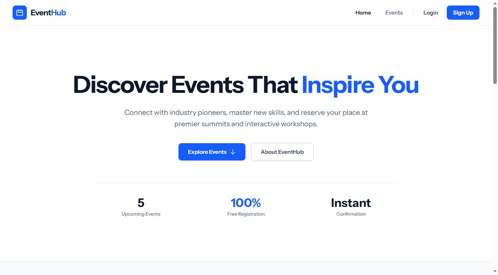
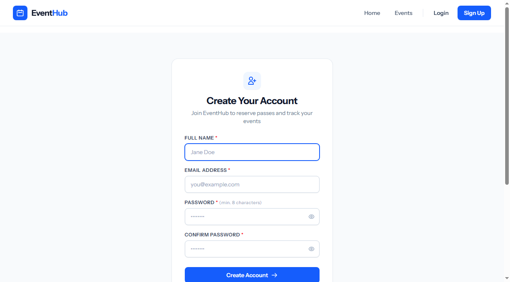
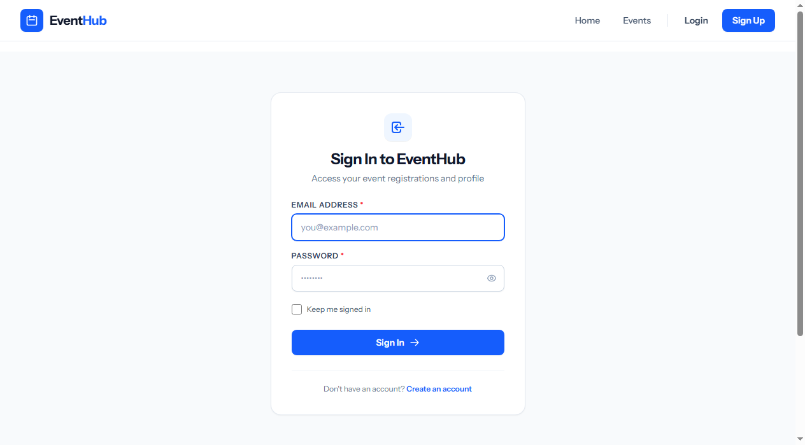
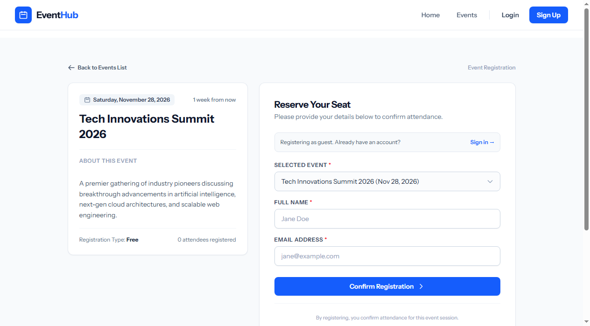
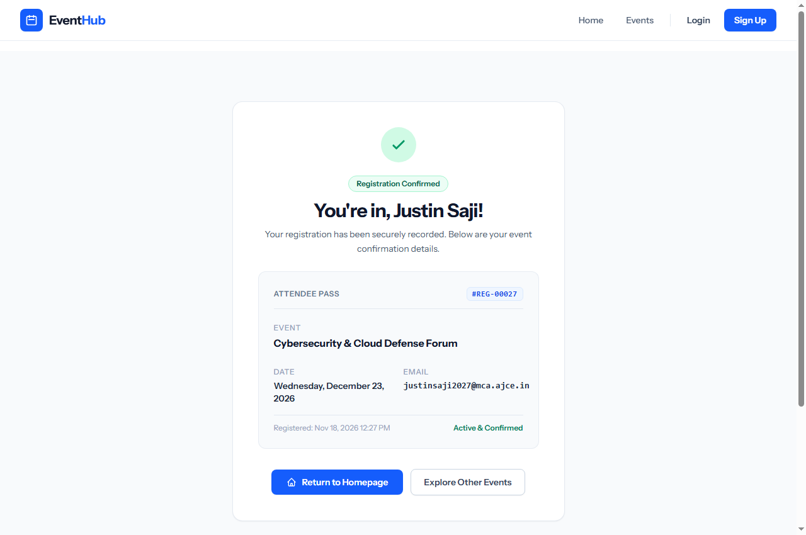
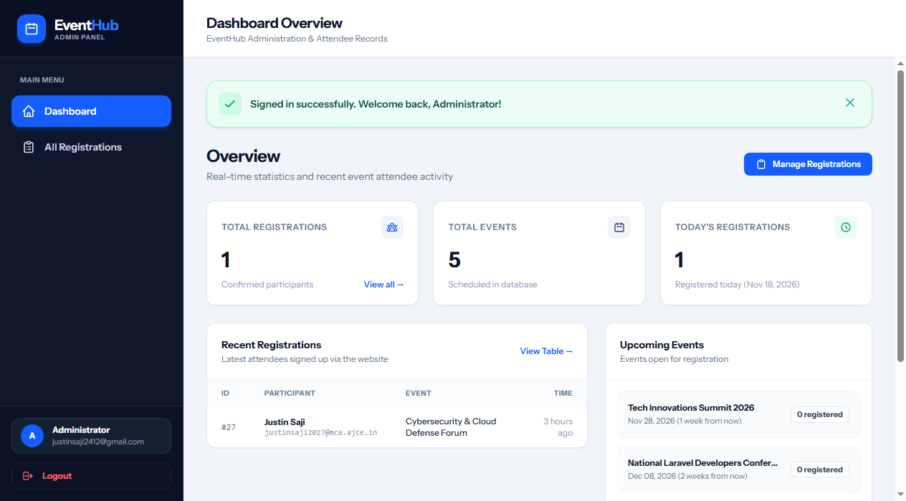
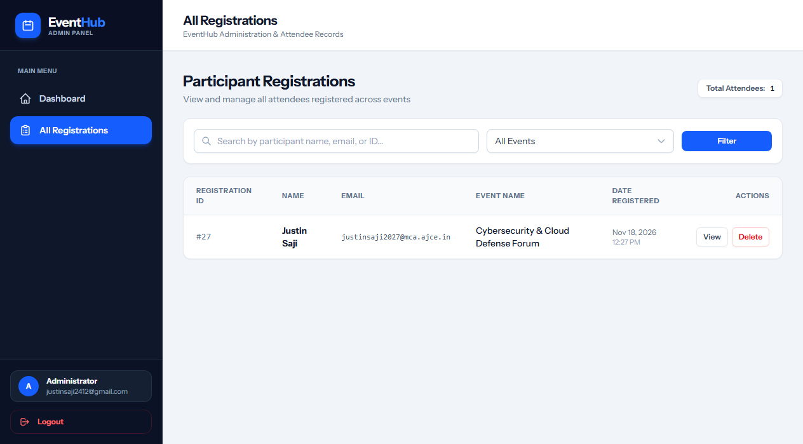

# EventHub — Laravel Event Registration Platform

EventHub is a modern, responsive, and secure Event Management & Registration web application built with **PHP Laravel 11**, **MySQL**, and **Vite / Tailwind CSS**.

The platform provides a seamless attendee journey for discovering upcoming summits and registering instantly, alongside a secure user account management system and a protected administrative dashboard with registration analytics.

---

## 🌐 Live Showcase & Documentation

* **Interactive GitHub Pages Website**: [https://justin-saji.github.io/Event_Hub-PHP-Laravel-Project/](https://justin-saji.github.io/Event_Hub-PHP-Laravel-Project/)
* **GitHub Repository**: [https://github.com/Justin-Saji/Event_Hub-PHP-Laravel-Project](https://github.com/Justin-Saji/Event_Hub-PHP-Laravel-Project)

---

## 📸 Screenshots

### 1. Public Homepage & Event Catalog
*Hero banner, event counters, keyword search filter, and dynamic upcoming event cards.*



### 2. User Authentication (Signup & Login)
*Secure account registration with email validation, Bcrypt password hashing, and session authentication.*





### 3. Event Registration Form
*Pre-populated attendee details with real-time event association and duplicate booking prevention.*



### 4. Registration Confirmation Pass
*Instant attendee confirmation pass with formatted event dates and confirmation reference details.*



### 5. Administrative Dashboard
*Protected back-office interface displaying live counters: Total Registrations, Active Events, and Today's Bookings.*



### 6. Attendee Registration Management
*Filterable and searchable attendee table with view modal details and safe record deletion.*



---

## 🚀 Key Features

### 🌐 Public Portal & Attendee Experience
* **Upcoming Events Catalog**: Real-time event listings retrieved dynamically from MySQL, automatically filtering past events.
* **Instant Event Registration**: Attendees can register with name and email, with automatic event ID association and protection against duplicate registrations.
* **Smart Form Pre-population**: Logged-in users have their profile details automatically populated for instant, one-click registration.
* **Success & Confirmation Pass**: Dedicated attendee pass page with formatted dates and clear confirmation details.

### 👤 User Authentication & Profile Management
* **Secure Registration**: Full account signup with name, email uniqueness validation, and strong password validation.
* **Bcrypt Password Security**: Passwords hashed securely using bcrypt; plain text is never persisted.
* **Privilege Guard**: Default user signup strictly enforces `is_admin = false` to prevent privilege escalation.
* **My Account / Profile**: Attendees can review their account details and view all their booked events.

### 🛡️ Administrative Dashboard & Management
* **Dedicated Admin Authentication**: Secure login portal verifying `is_admin = true` authorization middleware.
* **Real-Time Analytics**: Summary metric cards tracking Total Registrations, Total Active Events, and Today's Registrations.
* **Full Registrations Management**:
  * Search attendees by name or email.
  * Filter registrations by specific event.
  * Paginated table records with full sorting.
  * Detailed attendee view modal / page.
  * Secure delete action with confirmation and success flash alerts.
* **Security & Cache Headers**: Anti-back-button cache control prevents protected data from lingering in browser cache after logout.

---

## 🛠️ Technology Stack

* **Backend Framework**: [Laravel 11.x](https://laravel.com)
* **Programming Language**: PHP 8.2+ / 8.3+
* **Database**: MySQL / MariaDB (XAMPP compatible)
* **Frontend Architecture**: Laravel Blade, HTML5, Vanilla JavaScript
* **Styling & Design System**: Tailwind CSS (via Vite)
* **Asset Bundler**: Vite 6.x

---

## ⚙️ Installation & Setup

### 1. Clone Repository
```bash
git clone https://github.com/Justin-Saji/Event_Hub-PHP-Laravel-Project.git
cd Event_Hub-PHP-Laravel-Project
```

### 2. Install Dependencies
```bash
composer install
npm install
```

### 3. Environment Configuration
Copy `.env.example` to create your `.env`:
```bash
cp .env.example .env
php artisan key:generate
```

Configure your MySQL database credentials in `.env`:
```ini
DB_CONNECTION=mysql
DB_HOST=127.0.0.1
DB_PORT=3306
DB_DATABASE=event_registration
DB_USERNAME=root
DB_PASSWORD=

SESSION_DRIVER=database
CACHE_STORE=database
QUEUE_CONNECTION=sync

ADMIN_EMAIL=admin@eventhub.test
ADMIN_PASSWORD=your_secure_admin_password
```

### 4. Database Setup & Seeders
Run safe migrations and seed initial upcoming events and administrator accounts:
```bash
php artisan migrate
php artisan db:seed --class=EventSeeder
php artisan db:seed --class=AdminUserSeeder
```

### 5. Build Assets & Start Application
```bash
npm run build
php artisan serve
```

Access the application in your browser at `http://localhost:8000`.

---

## 🧪 Testing & Verification

The project includes custom automated test suites covering authentication, authorization, CRUD operations, and full technical audits:

```bash
# Run User Authentication & Authorization Suite (19 tests)
php tests/test_auth_system.php

# Run Full 40-Point Security & Quality Audit Suite
php tests/audit_runner.php
```

---

## 📄 License

The EventHub application is open-sourced software licensed under the [MIT License](LICENSE).
